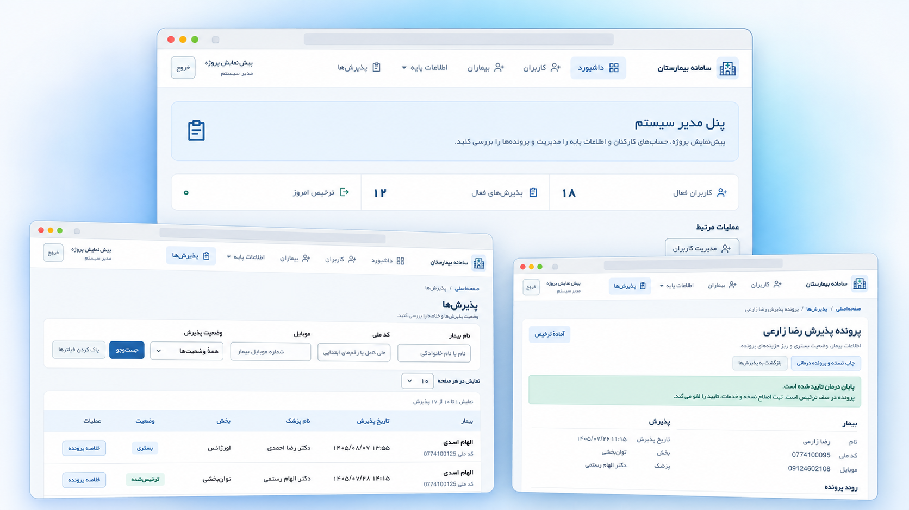

# سامانه بیمارستان

سامانه‌ای فارسی و راست‌به‌چپ برای ثبت بیمار، پذیرش، درمان و ترخیص با **PHP 8.2+، Yii 2 و MariaDB**. تاریخ‌ها در پایگاه داده میلادی ذخیره می‌شوند و در رابط کاربری به‌شکل شمسی نمایش داده می‌شوند.



> این پروژه برای اجرا و توسعهٔ محلی تهیه شده است. پیش از استفاده در محیط عملیاتی، تنظیمات سرور، دسترسی‌ها، پشتیبان‌گیری و الزامات حفاظت از داده‌های بیمار را متناسب با محیط خود بررسی کنید.

## امکانات

- ثبت بیمار و پذیرش او با پزشک و بخش انتخابی؛ هر بیمار در هر زمان فقط یک پذیرش فعال دارد.
- ثبت خدمات، نسخه، دارو و اقلام مصرفی توسط پزشکِ مسئول؛ اصلاح پیش از ترخیص با دلیل و سابقهٔ تغییرات.
- تأیید پایان درمان توسط پزشک، بررسی هزینه و ثبت ترخیص توسط ترخیص‌کار.
- چاپ مستقل پروندهٔ درمانی و رسید مالی؛ اطلاعات مالی رسید هنگام ترخیص ثبت می‌شود و با تغییر تعرفه‌های بعدی عوض نمی‌شود.
- مدیریت حساب کارکنان، پزشکان، بخش‌ها، خدمات و فهرست مرجع دارو و مصرفی توسط مدیر سیستم.
- داشبورد متناسب با نقش که هنگام بازبودن صفحه هر ۳۰ ثانیه در پس‌زمینه به‌روز می‌شود.

### نقش‌ها و دسترسی

| نقش | کارهای اصلی |
| --- | --- |
| مدیر سیستم | مدیریت کارکنان و اطلاعات پایه؛ مشاهدهٔ پرونده‌ها و هزینه‌ها |
| منشی | ثبت و ویرایش بیمار، ایجاد پذیرش و مشاهدهٔ اطلاعات اداری |
| پزشک | مشاهدهٔ پذیرش‌های اختصاص‌یافته، ثبت و اصلاح درمان، تأیید پایان درمان و چاپ پروندهٔ درمانی |
| ترخیص‌کار | مشاهدهٔ پرونده‌های آمادهٔ ترخیص یا ترخیص‌شده، بررسی هزینه، ثبت ترخیص و چاپ رسید |

ثبت‌نام عمومی وجود ندارد. دسترسی مسیرها در `app/components/Access.php` و کنترلرهای مبتنی بر `RoleController` در سمت سرور بررسی می‌شود. پزشک فقط پرونده‌های اختصاص‌یافته به خودش را می‌بیند؛ ترخیص‌کار فقط پرونده‌های آمادهٔ ترخیص یا ترخیص‌شده را مشاهده می‌کند. مدیر عملیات ثبت پذیرش، درمان و ترخیص را انجام نمی‌دهد.

## پیش‌نیازها

- PHP **8.2 یا بالاتر** با افزونه‌های `pdo_mysql`، `mbstring` و `intl`؛ افزونه‌های موردنیاز Yii و Composer را نیز فعال کنید.
- Composer 2 و MariaDB؛ فایل SQL برای نصب روی پایگاه دادهٔ خالی تهیه شده است.
- وب‌سرور با ریشهٔ `app/web` و دسترسی نوشتن PHP به `app/runtime` و `app/web/assets`.
- برای دستورهای اجرای محلی این README: Windows، Nginx و PHP FastCGI. مسیرهای پیش‌فرض اسکریپت در بخش «اجرای محلی» آمده‌اند.

## نصب از صفر

دستورها را از ریشهٔ مخزن اجرا کنید. مراحل مربوط به پایگاه داده فقط برای **نصب تازه** هستند؛ فایل `database/install.sql` را روی دیتابیس دارای داده اجرا نکنید. این مخزن اسکریپت مهاجرت یا ارتقای دیتابیس موجود ندارد.

### ۱. نصب وابستگی‌ها

```powershell
composer --working-dir=app install --no-dev
New-Item -ItemType Directory -Force .\app\runtime, .\app\web\assets
```

برای توسعهٔ محلی در صورت نیاز به بسته‌های توسعه، `--no-dev` را حذف کنید. پوشهٔ `app/vendor` و فایل‌های تولیدشده در گیت ثبت نمی‌شوند.

### ۲. ساخت پایگاه داده و تنظیم اتصال

یک دیتابیس خالی با charset برابر `utf8mb4` و collation برابر `utf8mb4_unicode_ci` بسازید و سپس `database/install.sql` را در آن وارد کنید. این فایل ۱۲ جدول و چند دادهٔ مرجع اولیه برای پزشکان، خدمات و اقلام درمانی می‌سازد؛ داده‌های نمونه صرفاً آموزشی‌اند.

فایل `app/config/db.php` را با مشخصات دیتابیس همان نصب بسازید:

```php
<?php
return [
    'class' => \yii\db\Connection::class,
    'dsn' => 'mysql:host=127.0.0.1;port=3306;dbname=hospital',
    'username' => 'your-local-username',
    'password' => 'your-local-password',
    'charset' => 'utf8mb4',
];
```

برای اجرای برنامه، حساب دیتابیس به مجوز ساخت جدول نیاز ندارد. ساخت دیتابیس و واردکردن SQL را با حسابی انجام دهید که مجوز لازم را دارد.

### ۳. ساخت کلید کوکی

برای هر نصب، یک کلید تصادفی مستقل ایجاد کنید. در PowerShell:

```powershell
$cookieKey = & php -r 'echo bin2hex(random_bytes(32));'
Set-Content -Path .\app\config\cookie-key.php -Value "<?php return '$cookieKey';"
```

به‌جای فایل، می‌توانید متغیر محیطی `HOSPITAL_COOKIE_VALIDATION_KEY` را با کلیدی تصادفی و حداقل ۳۲ کاراکتر تنظیم کنید. متغیر محیطی بر فایل محلی اولویت دارد. تغییر کلید، کوکی‌های ورود قبلی را نامعتبر می‌کند. فایل‌های `app/config/db.php` و `app/config/cookie-key.php` در `.gitignore` هستند؛ آن‌ها را منتشر نکنید.

### ۴. ساخت اولین مدیر

فایل SQL حساب کاربری پیش‌فرض نمی‌سازد. برای تولید hash رمز مدیر، این دستور را در PowerShell اجرا کنید؛ رمز از شما گرفته می‌شود و در فرمان ثبت نمی‌شود:

```powershell
$securePassword = Read-Host 'رمز قوی مدیر اولیه' -AsSecureString
$env:HOSPITAL_ADMIN_PASSWORD = [System.Net.NetworkCredential]::new('', $securePassword).Password
php -r 'echo password_hash(getenv("HOSPITAL_ADMIN_PASSWORD"), PASSWORD_DEFAULT), PHP_EOL;'
Remove-Item Env:HOSPITAL_ADMIN_PASSWORD
php -r 'echo bin2hex(random_bytes(32)), PHP_EOL;'
```

خروجی دستور سوم، hash رمز است و خروجی دستور آخر، کلید تصادفی حساب. آن‌ها را به‌ترتیب به‌جای `PASTE_PASSWORD_HASH` و `PASTE_RANDOM_AUTH_KEY` در SQL زیر قرار دهید و آن را **فقط یک‌بار، پس از نصب جدول‌ها** اجرا کنید. نام کاربری و نام نمایشی را به دلخواه تغییر دهید:

```sql
INSERT INTO users (username, full_name, password_hash, auth_key, role, is_active)
VALUES ('admin', 'مدیر سیستم', 'PASTE_PASSWORD_HASH', 'PASTE_RANDOM_AUTH_KEY', 'admin', 1);
```

پس از ورود، سایر حساب‌ها از داخل پنل مدیر ساخته می‌شوند. برای دیتابیس موجود که مدیر دارد، این مرحله را تکرار نکنید.

## اجرای محلی در Windows

فایل `deploy/nginx.conf` یک نمونهٔ تنظیمات است. مقدار `root` را به مسیر واقعی `app/web` در سیستم خود تغییر دهید و تنظیمات را در Nginx اعمال کنید. اسکریپت زیر به‌طور پیش‌فرض Nginx را در `C:\nginx` و PHP را در `C:\xampp\php` پیدا می‌کند؛ در صورت تفاوت مسیرها از پارامترهای `-NginxDirectory` و `-PhpDirectory` استفاده کنید.

MySQL/MariaDB را اجرا کنید و در یک پنجرهٔ PowerShell، از ریشهٔ مخزن فرمان زیر را بزنید:

```powershell
powershell.exe -NoProfile -ExecutionPolicy Bypass -File .\scripts\Start-Hospital.ps1
```

این اسکریپت تنظیمات Nginx را بررسی می‌کند، Nginx را راه می‌اندازد یا بازبارگذاری می‌کند و PHP FastCGI را روی `127.0.0.1:9000` اجرا می‌کند. پنجرهٔ آن را باز نگه دارید. اگر پورت ۹۰۰۰ از قبل در حال استفاده باشد، اسکریپت متوقف می‌شود. سپس صفحهٔ [ورود به سامانه](http://localhost:8080/site/login) را باز کنید.

در سرورهای دیگر نیز ریشهٔ وب باید `app/web` باشد؛ کل مخزن یا پوشهٔ `app` را به‌عنوان ریشهٔ عمومی وب قرار ندهید. `YII_DEBUG` و محیط برنامه در `app/web/index.php` به‌صورت پیش‌فرض برای اجرای production تنظیم شده‌اند.

## جریان پرونده و قواعد داده

1. منشی بیمار را ثبت می‌کند و برای او پذیرش با پزشک و بخش می‌سازد. ثبت هم‌زمان پذیرش فعال برای یک بیمار با قفل‌کردن ردیف بیمار کنترل می‌شود.
2. پزشکِ مسئول نسخه و خدمات را ثبت می‌کند. نام و قیمت اقلام از فهرست مرجع در سرور خوانده می‌شوند و قیمت ثبت‌شده در پرونده حفظ می‌شود.
3. اصلاح نسخه یا خدمت پیش از ترخیص، دلیل و سابقه دارد؛ تغییر هم‌زمانی که بر پایهٔ نسخهٔ قدیمی پرونده باشد با خطای `409` رد می‌شود.
4. پزشک پایان درمان را تأیید می‌کند. هر ثبت یا اصلاح درمانی پس از آن، تأیید قبلی را لغو می‌کند و تأیید دوباره لازم است.
5. ترخیص‌کار هزینه‌ها را بررسی و ترخیص را ثبت می‌کند. رسید مالی از نسخهٔ ثبت‌شده هنگام ترخیص خوانده می‌شود؛ تشخیص و دستور مصرف در آن نمایش داده نمی‌شود. چاپ پروندهٔ درمانی جداست.

## ساختار پروژه

| مسیر | کاربرد |
| --- | --- |
| `app/web/index.php` و `app/config/web.php` | نقطهٔ ورود و تنظیمات برنامه |
| `app/controllers/` و `app/models/` | مسیرهای درخواست، مدل‌های داده و اعتبارسنجی |
| `app/components/Access.php` و `RoleController.php` | مجوز نقش‌ها و محدودیت دسترسی به پرونده |
| `app/components/Billing.php` و `ReceiptSnapshot.php` | محاسبهٔ هزینه و ثبت نسخهٔ ثابت رسید |
| `app/views/` و `app/web/` | صفحه‌ها و فایل‌های عمومی CSS، JavaScript و فونت |
| `database/install.sql` | ساخت دیتابیس خالی و داده‌های مرجع اولیه |
| `deploy/nginx.conf` و `scripts/Start-Hospital.ps1` | نمونهٔ تنظیمات و اجرای محلی Windows |

## عیب‌یابی

| نشانه | بررسی پیشنهادی |
| --- | --- |
| `502 Bad Gateway` | اجرای PHP FastCGI و گوش‌دادن آن روی `127.0.0.1:9000` را بررسی کنید. |
| خطای اتصال دیتابیس | روشن‌بودن MariaDB، نام دیتابیس و اطلاعات `app/config/db.php` را بررسی کنید. |
| خطای کلید کوکی | فایل `app/config/cookie-key.php` یا متغیر `HOSPITAL_COOKIE_VALIDATION_KEY` را با مقدار حداقل ۳۲ کاراکتری تنظیم کنید. |
| مسیرهای صفحه باز نمی‌شوند | مقدار `root` و `try_files` در تنظیمات Nginx را بررسی کنید؛ ریشهٔ وب `app/web` است. |
| تاریخ شمسی یا قالب‌بندی درست نیست | فعال‌بودن افزونهٔ `intl` را در همان PHP که وب‌سرور اجرا می‌کند بررسی کنید. |

## مجوز فایل‌های همراه

مجوز وابستگی‌های نصب‌شده توسط Composer تابع بسته‌های خودشان است. `app/LICENSE.md` متن مجوز Yii و `app/web/fonts/LICENSE.txt` مجوز فونت یکان را نگه می‌دارند. برای کد اختصاصی این مخزن هنوز فایل مجوز مستقلی در ریشه تعیین نشده است.
